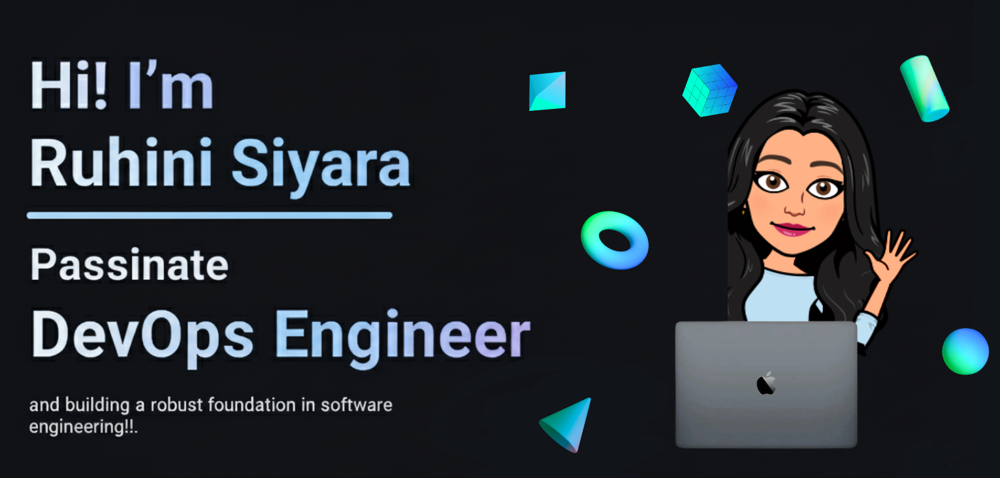

  

---
<h3 align="center">
  
</h3>

### ✨ About Me

- 🎓 Pursuing **Bachelor's of Information Technology Degree** @ University of Colombo
- 👩‍💻 Trainee Full-Stack Developer @ **ICET Campus Certified Developer Program**  
- 🌱 Learning: **DevOps, Cloud, AI Tools & Business Management with Marketing**  
- 💬 Ask me about: **Web dev, cloud & K8s, or Marketing management**  
- 👣 Growing byte by byte. Learning second by second.  
- 📫 Mail me: **ruhinisiyara@gmail.com** | [LinkedIn](https://www.linkedin.com/in/ruhini-siyara)  
- ⚡ Fun fact: I debug like I’m solving a crime scene 😂🔍

---

### 🛠️ Tech Stack & Tools

#### 💻 Frontend

  

#### 🧠 Backend

  

#### 🌐 MERN Stack

  

#### 🧰 DevOps + Tools

  

#### 🎨 3D & Creative

  

---

### 🚀 DevOps Certification Trail (Goal 🎯)

| Certification | Status |
|---------------|--------|
| 🟦 FinOps Certified Practitioner | 📍 Purchased Exam & Preparing for the Exam  (2027) |
| 🟩 AWS - AWS Certified Cloud Practitioner | 📍 Preparing for the Exam (2027) |
| 🟥 KodeKloud - DevOps Engineer certification course | 📍 In Progress (2027) |

---

### 📊 GitHub Activity

  
  
  

---

### 🏷️ Badges & Status

  
  
  
  
  

---

### 🔗 Connect With Me

  
  
  

<!-- Your profile content here... (skills, stack, about, etc.) -->
<!---
RuhiniSiyara/RuhiniSiyara is a ✨ special ✨ repository because its `README.md` (this file) appears on your GitHub profile.
--->
